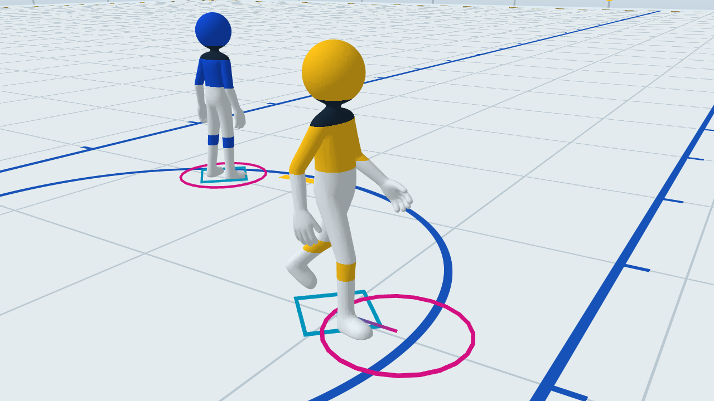

# 2026-11-26 개발 기록

## 서버 권위 걷기 애니메이션

- 서버 `de55c57`, Unity 클라이언트 `e27bd0a`의 원격 `main`을 기준으로 `codex/server-authoritative-animation` 브랜치를 만들었다. 현재 Unity 씬의 점프와 조준을 지원하기 위해 기존 점프·레이캐스트 커밋을 `81bc12e`로 적용하고 호환되는 카메라와 씬 연동 파일을 맞췄다.
- [참조 PoC](https://github.com/BaeJiwoo/PoC_ServerAuthoritative_Animation/tree/07384e54a585e700cdb0db5ecfd779ab75e842cc)에서 베이크된 걷기, 정지 자세, 본 계층과 OBB, 지연 보간을 확인했다. PoC 원본 .NET 테스트 57개가 WSL에서 통과했다. DeathWish는 자체 11본 리그와 1초 길이 60 Hz 제자리 걷기 테이블을 사용한다.
- Bepu가 확정한 수평 이동으로 서버의 yaw와 걷기 위상을 계산한다. 애니메이션 접속자는 위치, 시뮬레이션 시간과 관절을 같은 스냅샷으로 받고 Unity는 100ms 지연 타임라인으로 표시한다. 일반 접속자는 원래 위치 스냅샷을 받는다. 부위별 OBB 10개는 본 계층을 따라 계산하고 레이캐스트는 기존 Bepu 충돌체를 사용한다.
- WSL Release 전체 회귀에서 베이크 재현성, 혼합 실시간 TCP 접속, 벽과 입력 만료의 정지 자세, 1,024인 프레임, 본 계층과 OBB를 확인했다. Windows에서는 Unity 스크립트 빌드와 설치기 회귀가 통과했다.
- Windows Unity `6000.3.11f1` 배치 Play Mode에서 모든 본과 박스의 월드 좌표·회전을 서버 수치와 비교했다. 지연 보간, 수신·서버 시각 공백 이후 복구, 리그 불일치 처리, 외삽 없이 자세 유지, 퇴장을 확인했다. WSL 서버로 두 클라이언트가 실제 TCP 접속했고, 한 클라이언트의 이동이 상대 Unity 모델의 다리 회전과 위치에 반영됐다. 검증 프로세스는 종료했다.

- 실제 TCP 이동 검증을 다시 실행해 같은 플레이어의 정지·걷기 자세를 Unity 관찰 카메라로 1280×720 PNG 두 장에 담았다. 서버 포즈가 상대 Unity 모델에 반영되는 테스트가 통과했고 임시 서버와 중계를 종료했다.

## Bob과 위치 기즈모

- Unity 클라이언트에 `Characters/bob_rigged.fbx`를 추가했다. 서버의 관절 회전을 Bob 본의 바인드 좌표계로 변환하고, 임포트한 모델의 클립 재생을 끈 상태에서 적용했다. Bob이 설치된 클라이언트는 스킨 메시를 그린다. Bob이 없는 설치본은 박스로 포즈를 표시한다. [에셋 원본](https://github.com/BaeJiwoo/deathwish-assets/blob/1756331807ec1db8ec0a62e8836ce361070b08f7/Characters/bob_rigged.fbx)
- **Show Position Gizmos**는 최신 수신 서버 틱과 화면에 적용한 클라이언트 보간 위치를 함께 그린다. 자홍색 원은 서버 틱, 청록색 마름모는 보간 위치다. 두 위치가 다를 때 연결선을 그린다.
- Unity `6000.3.11f1` Play Mode에서 최신 틱과 보간 좌표, 표식의 표시 전환, 두 위치가 합쳐질 때 연결선 숨김, 플레이어 퇴장을 검증했다. WSL 서버에 실제 TCP로 연결한 두 클라이언트에서 Bob의 스킨 본 각도와 복제된 관절 각도가 0.1° 이내로 일치했다. 임시 검증 서버와 중계를 종료했다.
- Bob이 없는 Unity 복사본에서 박스 표시로 돌아가는 동작을 확인했다. Unity 스크립트 컴파일과 설치기 회귀도 통과했다.

**정지**에서는 두 표식의 중심이 같은 위치에 있다.

**걷기**에서는 캡처 시점의 최신 수신 위치가 보간 위치보다 약 0.49m 앞서 있다.

다음 시작점은 이 구현 단계의 코드 리뷰다. [프로토콜](../Protocol.md#animated-world-snapshot)과 [검증 절차](../Testing.md#11-서버-권위-걷기-애니메이션)를 정리했다.

## Linux MockClient terminal movement

- Added an interactive non-Windows `/wasd` mode for animation checks. W/A/S/D select a persistent direction; Space stops and Escape stops and exits. Terminal input cannot reliably report key release or focus, so this differs from Windows hold-to-move controls.
- Verified `dotnet build mockclient/DeathWish.MockClient.Console --no-restore` succeeds without warnings or errors. Started a new MockClient against the local server; interactive movement and Unity animation remain to be verified.

### Stop after terminal input expires

- Changed Linux terminal movement to stop 250 ms after the last movement key event instead of sending the selected direction indefinitely. Space still stops immediately and Escape exits.
- Verified the MockClient build succeeds with zero warnings and errors. Interactive movement and Unity animation have not been rechecked for this change.
- Terminals do not normally report key release or focus loss. Key repeat delay can cause a brief pause when movement begins, and stopping can take up to approximately 250 ms plus processing time.

## 단색 클라이언트 마테리얼

- 월드 셰이더의 격자, 벽 장식, 경고 줄무늬 및 캐릭터 음영을 제거하고 마테리얼 색상을 그대로 표시하도록 변경했다. 경고 영역은 단색 노랑으로 유지했다. 서버 설치 원본과 클라이언트 사본을 동기화했다.
- 원본과 사본의 일치 여부 및 변경 사항을 정적으로 확인했다. Unity 컴파일, Play 모드와 실제 서버 연결은 확인하지 않았다.

## 슈터 자세 구현 계획

- 조준·전진 걷기 FBX의 본, 기본 팔 자세, 클립 길이와 한 주기 전진량을 확인했다. [구현 계획](../ImplementationPlan.md)에 리타깃, 막대 소켓, 서버·Unity 공용 샘플러, 스냅숏 형식 및 두 클라이언트 검증 절차를 제안했다. 다음 단계는 Bob에 조준 클립을 적용해 양손과 막대 정렬을 확인하는 것이다.

## Bob 조준 자세와 막대 소품 · 첫 단계 구현

- Blender 5.2.1에서 ShooterPack의 `idle aiming.fbx`를 Bob 기준 상체·손가락 25개 본의 회전으로 베이크했다(30Hz, 62프레임). 재생성 검사와 Unity 임포트 기준 대조를 수행했다. 오른손 손잡이부터 막대 끝까지는 0.55m이며 소품 전체 길이는 0.64m다.
- Unity 설치 원본과 클라이언트에 포즈 리소스, 표시 코드, 클릭 시점의 막대 끝 좌표 저장을 적용했다. 타입 17의 보간된 시각으로 상체를 샘플링하며 하체와 물리 레이캐스트는 기존 서버 데이터를 사용한다.
- Unity 6000.3.11f1 API 컴파일 통과(경고·오류 0). Play 모드의 조준 대기와 보행 두 주기, 249개 샘플에서 왼손 지지점과 막대 중심선 사이 최대 거리는 1.79mm였다. 이동 후 모의 응답을 표시해 궤적의 첫 점이 클릭 당시 막대 끝과 일치함을 검증했다. Bob을 제외한 별도 실행에서 박스 대체 표시도 통과했다.
- 로컬 TCP 서버에 접속한 Unity와 이동 입력을 보내는 두 번째 클라이언트로 원격 Bob의 보행을 확인하고 [테스트 GIF](../media/shooter-aim-walk.gif)를 녹화했다. Linux 검증 환경에서 PowerShell 설치 회귀는 실행하지 않았다. 첫 단계 리뷰 후 다음 작업은 전진 걷기 클립의 베이크와 서버·클라이언트 공용 샘플러다.

## 캐릭터 무광 단색 머티리얼 수정

- 위의 단색 월드 변경을 복구하고 캐릭터에만 텍스처 없는 Unity Standard 머티리얼을 적용했다. 로컬·원격 색상은 유지하며 Smoothness 0(roughness 1), Metallic 0과 모델 노멀로 조명을 받는다. 토러스·바닥·벽·경고선은 기존 월드 셰이더를 사용하고, 손에 든 막대는 별도의 회색 머티리얼을 사용한다.
- 직접광이 없는 테스트 씬에는 기본 방향광을 추가한다. Unity 6000.3.11f1 컴파일과 별도 프로젝트의 Play 모드에서 로컬·원격 캐릭터의 머티리얼 설정, 복구된 바닥 격자와 캐릭터 표면 음영을 확인했다.
- 실제 TCP로 이동한 원격 Bob을 다시 촬영해 README의 조준 보행 GIF를 무광 머티리얼과 복구된 월드가 보이는 영상으로 갱신했다.

## ShooterPack 전진 걷기

- `tools/animation/bake_walk.py`가 에셋 저장소의 `ShooterPack.zip` 안에서 `walk forward.fbx`를 읽는다. Blender로 FBX를 평가해 1초 주기를 60개 샘플로 변환했다. 앞뒤 관절 방향과 부모 관절의 방향 차이만 기록해 루트 이동을 제외했다. 기존 11본 리그, 보행 위상 계산, 17번 스냅숏, 명중 판정은 유지했다.
- Blender 5.2.1 재생성 검사 통과. 원본의 30개 프레임 모두에서 양쪽 허벅지·무릎의 앞뒤 각도를 독립적으로 비교해 최대 약 0.007° 차이를 확인했다. Release 빌드는 경고·오류 0건, `DeathWish.ConnectionTests`는 124개 PASS 출력과 종료 코드 0을 확인했다.
- Unity 6000.3.11f1 Play 모드에서 같은 시각의 서버 참조 포즈와 Bob 양쪽 허벅지·정강이 회전을 249회 비교했다. 왼손 지지점과 막대 사이 최대 오차는 1.79mm였다. 실제 TCP 보행을 다시 촬영해 [테스트 GIF](../media/shooter-aim-walk.gif)를 갱신했다. 원본의 골반 이동과 발목 회전은 전송하지 않으므로 발 접지는 FBX와 다를 수 있다. 보행 교체 리뷰 대기.
- 별도 Unity 검사에서 평지 위 Bob 스킨의 최저점을 측정했다. 정지 시 바닥과 일치했고 보행 주기 중에는 약 0.6–14.9cm 위에 있었다.

## 보행 상태 전송과 클라이언트 Animator

- Unity 입장 모드 2와 18번 스냅숏을 추가했다. 한 틱의 발 위치·방향과 걷기 여부(1바이트)·누적 보행 주기(4바이트)를 함께 보낸다. 서버는 물리 처리 후 수평 이동 5m당 한 주기를 누적한다. 위치 전용 또는 기존 관절각 연결도 같은 방에 입장할 수 있다. 새 모드 연결만 있는 방에서는 전송을 위해 관절 포즈를 계산하지 않는다.
- Unity가 ShooterPack 전진 걷기에서 추출한 골반·다리·발목·발가락 동작을 재생한다. Unity 6000.3.11f1에서 클립 재생성 결과가 바이트 단위로 일치했다. 원본 FBX와 Animator의 하체 관절 위치를 비교한 60개 시점의 최대 차이는 8.96mm였다. 원본의 한 주기 전진량 1.807m는 클립에서 제거했다.
- Release 빌드와 ConnectionTests(125개 PASS), Unity API 컴파일, PowerShell 7.6.0 설치·재설치 검증을 통과했다. 실제 TCP에서 서로 다른 세 가지 스냅숏의 혼합 접속과 원격 보행을 검증했다. 서버 벽 충돌, 점프, 다른 플레이어 피격 검사를 통과했다.
- Unity Play 모드에서 보행 주기 순환, 정지·재생, 보간 중 스냅숏 중단을 검사했다. Bob 모델을 제외한 별도 실행에서 박스 리그 대체 표시도 확인했다. 실제 원격 Bob을 녹화해 [README GIF](../media/shooter-aim-walk.gif)를 갱신했다. 서버의 한 주기 이동 거리와 원본 보폭 차이로 수평 발 미끄러짐이 생길 수 있다. 리뷰 대기.
- 평지 보행 샘플에서 스킨의 본 행렬과 바인드 포즈로 계산한 Bob 메시 최저점은 서버 바닥 기준 −7.44~+7.25mm였다. 별도의 발 IK는 적용하지 않았다.

## 카메라 방향 조준

- 이동 입력에 카메라 yaw·pitch를 더한 19번 패킷을 도입했다. 두 각도는 각각 0.01° 단위의 2바이트 값이다. 서버는 같은 순번의 이동·조준을 함께 수락하며, 이동이 멈추거나 입력이 만료된 뒤에도 마지막 조준 방향을 보관한다.
- Unity는 입장 모드 3으로 접속한다. 20번 스냅숏은 플레이어별 보행 상태와 함께 이동 방향과 카메라 방향을 구분해 전달한다. 7·17·18번 스냅숏은 기존 클라이언트가 계속 사용할 수 있다. 발사 시 서버는 클릭 시점에 캡처한 카메라 레이와 룸의 물리 바디로 명중을 판정한다.
- Release 빌드와 서버 ConnectionTests(127개 PASS)를 통과했다. 실제 TCP에서 제자리 조준, 이동 반대 방향 조준, 이전 순번 거부, 늦은 입장 및 입력 만료 후 방향 유지, 점프와 플레이어 피격을 확인했다. Unity API 컴파일과 PowerShell 7.6.0 설치·재설치 검사도 통과했다.
- Unity 6000.3.11f1 Play 모드와 실제 TCP로 제자리·이동 중의 양 끝 조준 경로를 확인하고 [원격 플레이어 GIF](../media/shooter-aim-walk.gif)를 다시 촬영했다. 카메라와 막대 간 각도 오차는 249개 샘플에서 최대 0.028°였다. 정지 클립 생성 시 Bob FBX의 임포트 설정을 클라이언트와 일치시켜 모델 기본 자세를 사용하도록 수정했다. 새 정지·걷기 클립의 재생성 검사를 통과했다. 리뷰 대기.

## Bob의 AR 소총 장착

- 에셋 저장소의 AR 3단계 LOD 메시와 4종의 PBR 텍스처로 충돌체 없는 `HeldRifle` 프리팹을 구성했다. 모델 원점과 왼손 지지점, Unity에서 확인한 총열 끝의 총구 소켓을 사용한다. 소총은 원본 크기로 장착하고 오른손 손바닥과 손잡이를 일치시킨 뒤 왼팔 두 관절을 풀어 왼손이 앞쪽 소켓을 받치게 했다.
- Unity 클라이언트와 설치 원본을 동기화했다. 조준 클립 베이커에서 막대 전용 메타데이터를 제거했다. Blender 5.2.1 재생성 검증, Unity 6000.3.11f1 API 컴파일 및 PowerShell 설치·재설치 회귀를 통과했다. 서버 패킷·피격 판정은 기존 카메라 레이를 사용하고 궤적은 로컬 총구에서 시작한다.
- Unity 6000.3.11f1 Play 모드에서 실제 AR 메시와 재질을 로드해 249개 자세에서 두 손의 접점과 총구 방향을 검사했다. 실제 TCP로 같은 방에 들어간 로컬·원격 캐릭터의 장착, 제자리 조준·이동 및 클릭 시점의 궤적을 확인하고 양쪽 [README GIF](../media/shooter-aim-walk.gif)를 교체했다.

## 좌클릭 사격 반동과 원격 발사 이벤트

- Unity의 입장 모드 4는 기존 20번 조준·보행 스냅숏과 21번 ShotFired 이벤트를 함께 구독한다. 서버는 실제 카메라 레이를 처리한 틱에 사수의 플레이어 ID와 서버 시각을 같은 방의 다른 구독자에게 전송한다. 명중·빗나감 결과는 사수에게만 응답한다. 일반 스냅숏과 독립적인 이벤트이므로 같은 스냅숏 간격 안의 여러 발도 각각 전달된다.
- Release 빌드와 ConnectionTests(129개 PASS)를 통과했다. 실제 TCP로 연속 명중·빗나감, 사수 중복 반동 방지, 방 분리, 늦은 입장 시 과거 이벤트 제외, 기존·신규 클라이언트의 혼합 접속을 확인했다.
- Unity 컴파일·Play 모드·설치 회귀와 실제 TCP 연동에서 즉시 재생, 연속 발사, 지연 도착 및 원격 관찰을 확인했다. 서버 명중 판정은 발사 전 캡처한 레이를 사용한다. [README 녹화](../media/shooter-aim-walk.gif)는 원격 캐릭터의 정지·이동 중 사격을 보여 준다. 리뷰 대기.
