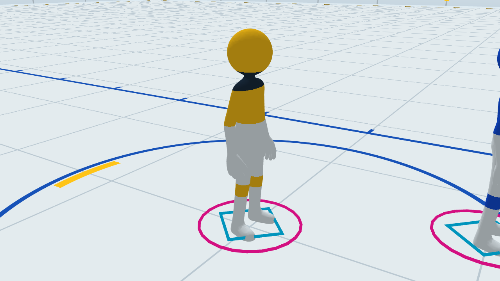

# 2026-11-26 개발 기록

## 서버 권위 걷기 애니메이션

- 서버 `de55c57`, Unity 클라이언트 `e27bd0a`의 원격 `main`을 기준으로 `codex/server-authoritative-animation` 브랜치를 만들었다. 현재 Unity 씬의 점프와 조준을 지원하기 위해 기존 점프·레이캐스트 커밋을 `81bc12e`로 적용하고 호환되는 카메라와 씬 연동 파일을 맞췄다.
- [참조 PoC](https://github.com/BaeJiwoo/PoC_ServerAuthoritative_Animation/tree/07384e54a585e700cdb0db5ecfd779ab75e842cc)에서 베이크된 걷기, 정지 자세, 본 계층과 OBB, 지연 보간을 확인했다. PoC 원본 .NET 테스트 57개가 WSL에서 통과했다. DeathWish는 자체 11본 리그와 1초 길이 60 Hz 제자리 걷기 테이블을 사용한다.
- Bepu가 확정한 수평 이동으로 서버의 yaw와 걷기 위상을 계산한다. 애니메이션 접속자는 위치, 시뮬레이션 시간과 관절을 같은 스냅샷으로 받고 Unity는 100ms 지연 타임라인으로 표시한다. 일반 접속자는 원래 위치 스냅샷을 받는다. 부위별 OBB 10개는 본 계층을 따라 계산하고 레이캐스트는 기존 Bepu 충돌체를 사용한다.
- WSL Release 전체 회귀에서 베이크 재현성, 혼합 실시간 TCP 접속, 벽과 입력 만료의 정지 자세, 1,024인 프레임, 본 계층과 OBB를 확인했다. Windows에서는 Unity 스크립트 빌드와 설치기 회귀가 통과했다.
- Windows Unity `6000.3.11f1` 배치 Play Mode에서 모든 본과 박스의 월드 좌표·회전을 서버 수치와 비교했다. 지연 보간, 수신·서버 시각 공백 이후 복구, 리그 불일치 처리, 외삽 없이 자세 유지, 퇴장을 확인했다. WSL 서버로 두 클라이언트가 실제 TCP 접속했고, 한 클라이언트의 이동이 상대 Unity 모델의 다리 회전과 위치에 반영됐다. 검증 프로세스는 종료했다.

- 실제 TCP 이동 검증을 다시 실행해 같은 플레이어의 정지·걷기 자세를 Unity 관찰 카메라로 1280×720 PNG 두 장에 담았다. 서버 포즈가 상대 Unity 모델에 반영되는 테스트가 통과했고 임시 서버와 중계를 종료했다.

## Bob과 위치 기즈모

- Unity 클라이언트에 `Characters/bob_rigged.fbx`를 추가했다. 서버의 관절 회전을 Bob 본의 바인드 좌표계로 변환하고, 임포트한 모델의 클립 재생을 끈 상태에서 적용했다. Bob이 설치된 클라이언트는 스킨 메시를 그린다. Bob이 없는 설치본은 박스로 포즈를 표시한다. [에셋 원본](https://github.com/BaeJiwoo/deathwish-assets/blob/1756331807ec1db8ec0a62e8836ce361070b08f7/Characters/bob_rigged.fbx)
- **Show Position Gizmos**는 최신 수신 서버 틱과 화면에 적용한 클라이언트 보간 위치를 함께 그린다. 자홍색 원은 서버 틱, 청록색 마름모는 보간 위치다. 두 위치가 다를 때 연결선을 그린다.
- Unity `6000.3.11f1` Play Mode에서 최신 틱과 보간 좌표, 표식의 표시 전환, 두 위치가 합쳐질 때 연결선 숨김, 플레이어 퇴장을 검증했다. WSL 서버에 실제 TCP로 연결한 두 클라이언트에서 Bob의 스킨 본 각도와 복제된 관절 각도가 0.1° 이내로 일치했다. 임시 검증 서버와 중계를 종료했다.
- Bob이 없는 Unity 복사본에서 박스 표시로 돌아가는 동작을 확인했다. Unity 스크립트 컴파일과 설치기 회귀도 통과했다.

**정지**에서는 두 표식의 중심이 같은 위치에 있다.

**걷기**에서는 캡처 시점의 최신 수신 위치가 보간 위치보다 약 0.49m 앞서 있다.

다음 시작점은 이 구현 단계의 코드 리뷰다. [프로토콜](../Protocol.md#animated-world-snapshot)과 [검증 절차](../Testing.md#11-서버-권위-걷기-애니메이션)를 정리했다.
